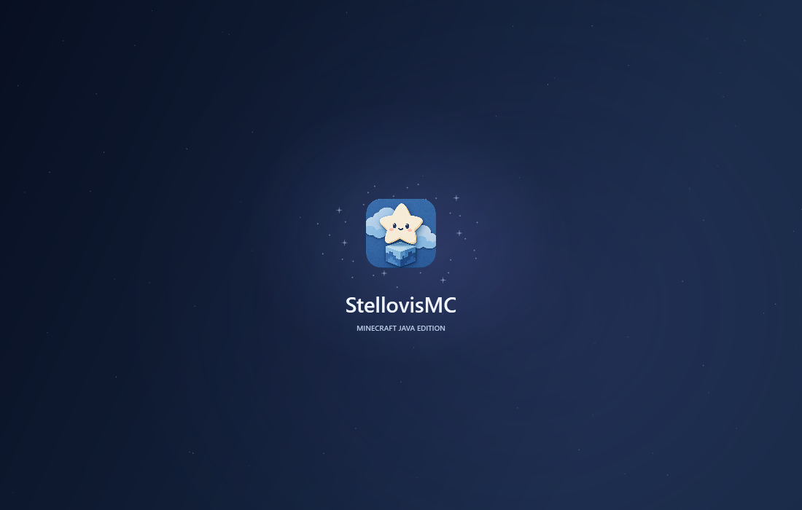

<div align="center">


# StellovisMC

A Windows desktop launcher for Minecraft: Java Edition.

星空、磨砂玻璃与轻盈交互，为下一段冒险准备的 Minecraft Java 启动器。

</div>

StellovisMC 是第三方基于 [PCL-CE](https://github.com/PCL-Community/PCL-CE) 及 [Plain Craft Launcher](https://github.com/Meloong-Git/PCL) 独立修改的项目，保留其游戏实例管理、下载与账户登录架构，并重新设计品牌与外观。原作者：**龙腾猫跃**；原社区版本：**PCL Community**。本项目与 Mojang、Microsoft、原作者及 PCL 社区不存在官方隶属或背书关系。

Not an official Minecraft product. Not approved by or associated with Mojang or Microsoft.

## 当前外观与功能

- 日系卡通剪纸风格的星星图标与 StellovisMC 品牌。
- 明暗主题、透明磨砂侧栏、圆角卡片及平滑页面过渡。
- 星云背景、闪烁星点、漂浮星尘和间歇流星；窗口后台暂停背景绘制。
- 约 1.1 秒的星光汇聚启动动画；支持关闭动画及系统减少动画设置。
- 启动器数据保存于程序旁的 `StellovisMC/`，首次运行自动迁移旧 `PCL/` 数据。
- Minecraft Java 实例管理、版本安装与资源管理沿用上游架构。



## Microsoft 登录状态

本项目使用**自己的 Microsoft 应用注册**，通过设备代码流程登录个人 Microsoft 账号，权限为 `XboxLive.signin offline_access`。用户在微软的登录网页完成身份验证，启动器不收集 Microsoft 密码。

目前已验证设备代码、Microsoft OAuth、Xbox Live 与 XSTS 流程。**Minecraft Services 返回 403，当前应用的 Minecraft API 访问申请尚待提交及审批，完整正版登录和游戏启动尚未验证成功。** 注册 Microsoft 应用本身不等于取得 Minecraft API 准入。

公开的 Application (client) ID：`415dda5e-8275-43a0-935c-f0347c3eb2d6`。该 ID 是公开应用标识，并非 Client Secret。详细配置见 [Microsoft OAuth 说明](branding/Microsoft-OAuth.md)。

## 环境与编译

桌面程序基于 **.NET 10 / WPF**，在 Windows 上运行。开发需要 .NET 10 SDK；下方命令生成 x64、依赖 .NET 10 Desktop Runtime 的单文件程序。

```powershell
dotnet restore ".\Plain Craft Launcher 2\Plain Craft Launcher 2.csproj" -p:Platform=x64
dotnet publish ".\Plain Craft Launcher 2\Plain Craft Launcher 2.csproj" -c Release -p:Platform=x64 --self-contained false -o .\dist\StellovisMC
```

运行输出目录中的 `StellovisMC.exe`。构建不需要 Microsoft Client Secret。上游内部项目名和命名空间仍保留为 `PCL.*`，Minecraft 实例元数据路径保留兼容性。

## 验证状态

针对数据迁移、星空渲染、启动动画、Microsoft 登录配置及剪贴板 STA 调度的 **12 项关联回归测试通过**；本地 Release 发布编译通过。上游全量测试仍存在语言资源、编码初始化、缓存及测试宿主等失败项，完整测试集尚未全部通过。

```powershell
dotnet test .\PCL.Core.Test\PCL.Core.Test.csproj -c Release --filter "FullyQualifiedName~DataDirectoryMigrationTest|FullyQualifiedName~StarfieldBackgroundTest|FullyQualifiedName~StartupAnimationTest|FullyQualifiedName~MicrosoftLoginConfigurationTest|FullyQualifiedName~WpfClipboardServiceTest"
```

剪贴板回归测试会短暂写入固定测试内容，并在结束后还原剪贴板。请在本机交互桌面环境运行。

## 上游与许可证

- 原作者 **龙腾猫跃**：[源项目](https://github.com/Meloong-Git/PCL)、[赞助](https://afdian.com/a/LTCat)。
- 社区基础项目：[PCL-Community/PCL-CE](https://github.com/PCL-Community/PCL-CE)。
- `Plain Craft Launcher 2/` 继续保留上游的 [PCL 分发有限许可及合理使用指南](Plain%20Craft%20Launcher%202/LICENCE)，其中包含二次创作的署名、名称及分发相关要求。
- 其他部分沿用 [Apache License 2.0](LICENSE) 及文件中已有的第三方许可声明。
- 原始项目说明保存在 [README-UPSTREAM.md](README-UPSTREAM.md)。

本仓库保留原有版权和许可文本；请在使用或分发相关代码及资源前阅读对应文件。
